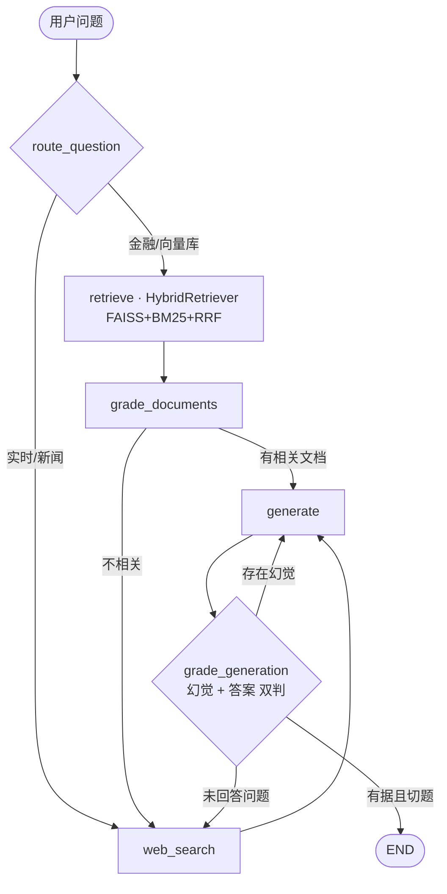

# 金融多跳问答 Agentic RAG（LangGraph · 混合检索 · LoRA/GRPO · vLLM/Ray）

> 面向**金融研报/年报**的、可**自纠错**、可**评测**、可**训练优化**的本地 Agentic RAG 全栈系统。
> 从合成数据、混合检索、多跳 QA 评测，到 LoRA/GRPO 后训练与 vLLM/Ray/FSDP 服务化并行调度，端到端打通 P0–P8，全部在 2×A100 上真实跑通。

**技术栈**：LangGraph · LangChain 1.x · FAISS · BM25(jieba) · BAAI/bge-base-zh · sentence-transformers · trl/peft（LoRA·GRPO）· vLLM · Ray · FSDP(accelerate) · Qwen2.5

---

## 📌 项目概述（STAR）

### Situation｜背景
金融问答常需在**多份长文档**间做**多跳推理**：跨年度（“2023 营收较 2021 增长多少”）、跨主体（“某公司的供应商去年净利润”）、指标趋势（“毛利率三年走势”）。通用单轮 RAG 有三大痛点：① 单路检索（纯向量或纯关键词）对“公司＋年份”这类**实体＋数字**查询召回不全，多跳证据难以同时命中；② 生成易**幻觉**、不引用证据；③ 缺乏闭环评测与领域模型优化手段，且金融场景常要求**本地化部署**。

### Task｜目标
构建一个本地可复现的金融 Agentic RAG 系统：检索做**多路融合**提升多跳召回；生成具备**幻觉检测＋自纠错**闭环；建立**可量化评测**体系；并打通 **LoRA/GRPO 后训练**与 **vLLM/Ray/FSDP** 服务化与并行调度。

### Action｜技术选型与难点攻克
- **数据层（P1）**：合成 6 家虚构上市公司 × 3 年度 × 3 类文书（年报/公告/研报），内置**上下游供应链**关系以支撑多跳；多格式解析（MD/HTML/TXT，stdlib 零额外依赖）＋ 财务表格保真分块；统一 `Document` JSONL 供稠密/稀疏检索共用。
- **混合检索（P2，核心）**：FAISS（bge-zh 稠密）＋ BM25（jieba 稀疏）经 **RRF 融合** ＋ 元数据过滤 ＋ 可选 cross-encoder 重排；以 `HybridRetriever.invoke()` **保持 LangGraph 节点接口不变**，仅替换实现。
- **自纠错图**：LangGraph `route → retrieve → grade_documents → generate → grade_generation` 闭环，幻觉与答案**双重 LLM-Judge**，未通过按 `max_retries` 重生成/补检索。
- **多跳数据合成（P3）**：答案由结构化 facts **精确计算**（非 LLM 生成，保证 ground truth），自动定位 evidence chunk，产出 51 条可追溯多跳 QA（跨年度/上下游/指标变化/深链）。
- **评测体系（P4）**：检索 Recall@k / MRR / nDCG / **多跳全链 Hit@k**；生成 faithfulness / citation / answer-relevance；端到端 准确率 / 重试 / 延迟。
- **训练全链路（P5/P6）**：trl＋peft **LoRA SFT**（证据引用式回答 ＋ JSON 路由稳定性）；**GRPO** 后训练，奖励**复用 P4 评测指标**（正确性＋引用＋格式−幻觉），形成“评测→训练”闭环；并提供 **LLaMA-Factory / veRL** 生产档配置。
- **服务与调度（P7/P8）**：**vLLM** 起 OpenAI 兼容服务，LLM 后端经 `LLM_BACKEND` 一键切换 Ollama/vLLM；**Ray** 并行 ingestion/评测；**FSDP** 2×A100 多卡训练。

### Result｜量化成果
见下方「核心结果」，均为本机 2×A100 真实跑出（`docs/results.md` 与 `outputs/*.json` 为产物）。

---

## 📊 核心结果

### 1) 混合检索：多跳召回显著优于单路（51 条多跳 QA）
| 方法 | Recall@5 | Recall@10 | MRR | nDCG@5 | 多跳全链 Hit@5 |
|---|---|---|---|---|---|
| Dense（FAISS · bge-zh） | 0.441 | 0.657 | 0.453 | 0.339 | 0.000 |
| BM25（jieba） | 0.255 | 0.677 | 0.157 | 0.130 | 0.216 |
| **Hybrid（RRF）** | **0.569** | **0.784** | **0.596** | **0.469** | **0.255** |
| Hybrid + Reranker | 0.304 | 0.745 | 0.262 | 0.198 | 0.078 |

> Hybrid 相比 Dense：Recall@5 **+29%**、MRR **+32%**、nDCG@5 **+38%**。Dense 单路的**多跳全链命中为 0**（跨年财务表语义高度相似，难同时召回两跳证据），靠 BM25 的年份/实体 token 互补，RRF 融合后全链命中升至 **0.255**——印证混合检索对多跳问答的必要性。
>
> **消融发现（有深度的反直觉结果）**：朴素 cross-encoder reranker 在多跳场景**反而有害**（Hit@5 0.255→0.078、MRR 0.596→0.262）。它按单条 query-doc 相关性重排，会把**间接相关**的第二跳证据（另一年报/供应商报告）挤出 top-k。这说明多跳检索需要**多跳感知的重排**（future work），不能直接套用单跳 reranker——RRF 融合在多跳上仍是最优。

### 2) 端到端 Agentic RAG（vLLM · Qwen2.5-7B-Instruct，n=10）
| 答案准确率 | 引用覆盖率 | 忠实度(Judge) | 答案相关性(Judge) | 平均自纠错轮数 | 平均时延 |
|---|---|---|---|---|---|
| **0.68** | **0.95** | **0.70** | **0.80** | 1.2 | 6.87s |

### 3) LoRA SFT（trl＋peft · Qwen2.5-0.5B）
- 训练 loss **0.98 → 0.04** 收敛；in-domain 答案准确率 **0.825 → 0.900（+7.5pct）**（`outputs/sft_metrics.json`）

### 4) GRPO 后训练（trl · 奖励复用评测指标）
- 组合奖励 **2.53 → 2.79（+0.26）**，KL 受控（<0.03）；分量：正确性 0.70 / 引用 1.0 / 格式 0.5 / 无幻觉 0.59（`outputs/grpo_metrics.json`）

### 5) vLLM 推理服务（A100 单卡）
- 吞吐 **QPS@16 = 7.16**，p50 时延 **1.97s**；7B 多跳算例答对（120→158.7 亿 ⇒ **32.2%**）（`outputs/serve_metrics.json`）

### 6) 分布式（P8）
- **Ray** 并行评测：51 QA / 2 worker，wall **13.12s**，指标与串行完全一致
- **FSDP** 2×A100 多卡 SFT：8 步 loss 0.954、runtime 41.6s（验证多卡训练通路）

---

## 🏗️ 架构

自纠错工作流（保留基线闭环，仅替换检索实现）：



完整系统架构、模块映射与一致性设计见 **[docs/architecture.md](docs/architecture.md)**；完整指标见 **[docs/results.md](docs/results.md)**。

---

## 🚀 快速开始

```bash
# 1) 安装核心 RAG 依赖（建议独立 conda/venv）
make setup                       # pip install -r requirements.txt && pip install -e .

# 2) 构建语料 + 索引（P1 + P3 + P2）
make corpus                      # 合成金融语料 → ingest → 多跳 QA
make index                       # FAISS + BM25 索引

# 3) 跑一条多跳问答（打印自纠错节点轨迹）
make demo ARGS='-q "山河酒业2023年营业收入较2021年增长了多少？"'

# 4) 评测（检索 + 端到端 → docs/results.md）
make bench                       # 单独检索：make bench ARGS='--mode retrieval'

# 5) 训练（可选，需 GPU）
make install-train
make prepare-data && make sft    # LoRA SFT（trl+peft）
make grpo                        # GRPO 后训练

# 6) vLLM 服务（可选，需 GPU）
make install-serve
HF_HUB_OFFLINE=1 VLLM_GPU=1 VLLM_GPU_UTIL=0.9 make serve   # 起 Qwen2.5-7B-Instruct
make health                      # QPS / 延迟探测
LLM_BACKEND=vllm make demo ARGS='-q "..."'                 # 图改用 vLLM 后端

# 7) 分布式（可选）
make install-ray && make ray                                # Ray 并行评测
accelerate launch --config_file config/accelerate_fsdp.yaml \
    training/sft_lora.py --config config/sft_lora.yaml      # FSDP 2×A100
```

后端可切换：`LLM_BACKEND=ollama|vllm`；嵌入 `EMBEDDINGS_BACKEND=bge|nomic|hashing`（三级兜底，无模型/系统依赖时仍可跑通）。全部运行参数见 `.env.example`。

---

## 🗂️ 项目结构

```
src/agentic_rag/
├── config.py / schema.py / log.py / io_utils.py   # 单一配置源 / 统一数据契约 / 日志 / IO
├── llm.py / embeddings.py                          # Ollama·vLLM 工厂 / bge→nomic→hashing
├── ingestion/   (P1)  parsers·chunking·metadata·pipeline·synthetic
├── retrieval/   (P2)  dense_faiss·sparse_bm25·hybrid(RRF)·rerank·base
├── synthesis/   (P3)  samplers·generators·pipeline
├── graph/             state·nodes·edges·build（自纠错图）
└── eval/        (P4)  retrieval_metrics·generation_metrics·judge·benchmark
training/   (P5/P6)  prepare_data·sft_lora·grpo_train·rewards
serve/      (P7)     vllm_server.sh·healthcheck·openai_client
ray_jobs/   (P8)     parallel_ingest·parallel_bench   + config/accelerate_fsdp.yaml
config/             default.yaml·sft_lora·llamafactory_sft·grpo·verl_grpo·accelerate_fsdp
cli.py / main.py / Makefile / tests/                # 统一 CLI / 向后兼容入口 / 一键命令 / pytest
```

---

## 🔧 工程难点与解法（真实踩坑）

- **vLLM 在本机的多重坑**：① 启动联网校验 HF（SSL EOF）反复重试 → `HF_HUB_OFFLINE=1` 走本地缓存；② `gpu_memory_utilization=0.5` 在被占用的卡上算出 **KV cache 负值 OOM** → 选空闲卡 + util 0.9；③ `response_format` 的 **guided-decoding(xgrammar) 崩溃 `execute_model`** → JSON 不依赖原生约束，改“prompt 指令 + `parse_json` 容错”；④ **langchain-openai 1.x 自定义 TCP keepalive + 本机 SOCKS 代理**导致连不上 localhost → 禁 keepalive + 自动把 localhost 加入 `NO_PROXY` + 显式 `127.0.0.1`。
- **混合检索元数据过滤截断**：小 topk 初检后再过滤会丢掉符合条件的相关文档 → 检测到 filter 时**扩大初检广度**再过滤。
- **多跳 ground truth 可靠性**：QA 答案由结构化 facts **精确计算**而非 LLM 生成，evidence 可追溯到具体 chunk，使检索/引用指标可信。
- **依赖兼容性**：新版 transformers 在 import 期引用 `torch.float8_e8m0fnu`（torch 2.5 无）→ 锁定 **transformers 4.47.1 + sentence-transformers 3.4.1 + torch 2.5.1**，并分层 `requirements*.txt` 隔离 RAG/训练/服务依赖。
- **LangChain 1.x 适配**：Tavily 迁移到 `langchain-tavily`，向量库由 `SKLearnVectorStore` 整体替换为自研 FAISS+BM25，节点接口零改动。

---

## 🗺️ Roadmap 对照（P0–P8 全部落地）

| 阶段 | 内容 | 状态 | 关键产物 |
|---|---|---|---|
| P0 | 稳定运行层（统一配置/CLI/smoke test） | ✅ | `config.py`·`cli.py`·`tests/`（14 passed） |
| P1 | 金融数据 Ingestion | ✅ | 54 raw → 252 chunks |
| P2 | FAISS+BM25 混合检索 | ✅ | Hybrid Recall@5 0.569 |
| P3 | 多跳 QA 合成 | ✅ | 51 条可追溯多跳 QA |
| P4 | Judge 与 Benchmark | ✅ | `docs/results.md` |
| P5 | LoRA/SFT | ✅ | acc 0.825→0.90 |
| P6 | GRPO 后训练 | ✅ | reward 2.53→2.79 |
| P7 | vLLM 推理服务 | ✅ | QPS 7.16 / p50 1.97s |
| P8 | Ray + FSDP 调度 | ✅ | Ray 评测 13.12s / FSDP 2×A100 |

> 说明：训练与端到端评测的规模为 **smoke 级**（小语料、小模型、少步数），重在验证**全链路打通与相对提升**；脚本均可切换至 7B/更大步数做完整训练（见 `config/*.yaml` 注释）。

---

## 📄 License

MIT。本项目语料为**合成虚构**数据，公司名/财务数字均非真实，仅用于演示与复现。
