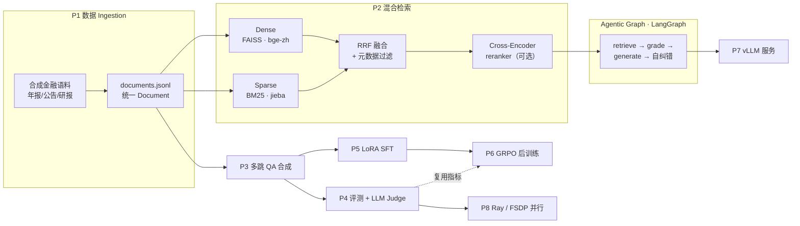
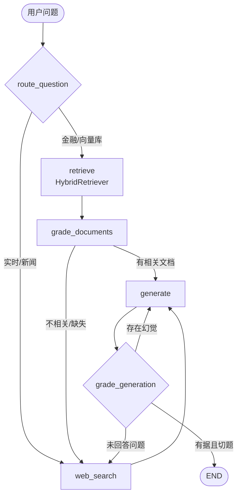

# 系统架构

## 总览

本项目把一个单文件的 LangGraph 自纠错 RAG demo，扩展为覆盖「**数据 → 检索 → 推理 → 评测 → 训练 → 服务 → 调度**」的金融多跳问答全栈系统（对应 `docs/technical-roadmap.md` 的 P0–P8）。

## 自纠错工作流（LangGraph）

保留基线的自纠错闭环，仅把检索实现替换为混合检索（节点接口不变）：

- **route_question**：金融关键词启发式优先，回退到 LLM JSON 路由。
- **grade_documents**：逐文档相关性打分，过滤无关文档。
- **generate**：基于检索上下文做多跳推理并引用数据。
- **grade_generation**：幻觉检测 + 答案有效性双重 Judge，未通过则按 `max_retries` 自纠错（重新生成 / 补充检索）。

## 模块映射

| 路线 | 目录 / 文件 | 职责 |
|---|---|---|
| 配置/契约 | `src/agentic_rag/{config,schema,log,io_utils}.py` | 单一配置源、统一数据模型、日志、JSONL IO |
| LLM/Embedding | `src/agentic_rag/{llm,embeddings}.py` | Ollama/vLLM 切换；bge→nomic→hashing 三级兜底 |
| P1 | `src/agentic_rag/ingestion/` | 合成语料、PDF/HTML/MD 解析、分块、元数据规范 |
| P2 | `src/agentic_rag/retrieval/` | FAISS + BM25 + RRF + 元数据过滤 + reranker |
| P3 | `src/agentic_rag/synthesis/` | 跨年度/上下游/指标变化证据链 → 多跳 QA |
| P4 | `src/agentic_rag/eval/` | Recall@k/MRR/nDCG、faithfulness/relevance、端到端 benchmark |
| Graph | `src/agentic_rag/graph/` | state/nodes/edges/build 自纠错图 |
| P5/P6 | `training/` | LoRA SFT、GRPO 奖励与训练 |
| P7 | `serve/` | vLLM OpenAI 服务、健康检查、客户端 |
| P8 | `ray_jobs/`、`config/accelerate_fsdp.yaml` | Ray 并行 ingestion/benchmark、FSDP 多卡训练 |
| 入口 | `cli.py`、`main.py`、`Makefile` | 统一 CLI、向后兼容入口、一键命令 |

## 一致性设计

- **单一配置源**：所有模块经 `config.get_settings()` 读取，`.env.example` ↔ `config/default.yaml` 一一对应。
- **统一数据契约**：`schema.Document` / `MultiHopQA` 贯穿 ingestion→retrieval→synthesis→eval→training。
- **接口不变**：`HybridRetriever.invoke(question)` 保持基线 `retriever.invoke` 契约，替换实现不动图结构。
- **后端无关**：LangGraph 节点不直接 import 任何具体 LLM 客户端，由 `llm.py` 工厂按 `LLM_BACKEND` 注入。
